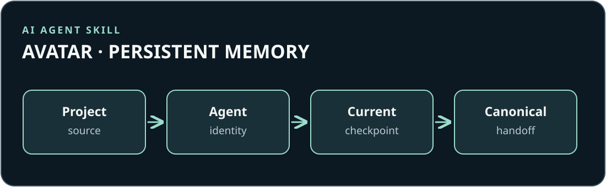

# Avatar — Persistent Memory Skill

**An AI agent skill for project identity, durable context and structured handoffs.**

Avatar helps an assistant resume work across conversations without pretending that a new chat inherits inaccessible internal state. It uses a user-owned Notion workspace as the source of truth, with a registry of agent identities, operational checkpoints and a single canonical handoff per identity.

## Workflow at a glance



Avatar is an **agent instruction skill**, not a standalone app. The diagram shows the intended sequence; each step depends on reading and verifying the user's own authorized Notion records. The slash commands below are text triggers, not guaranteed native commands.

## Capabilities

- `/new` — create a verified project or operational identity without duplicating existing pages.
- `/resume` — restore the current identity, checkpoint and relevant dependencies from the connected source of truth.
- `/save` — reconcile new decisions and verified state with existing documentation.
- `/handoff` — prepare a durable successor handoff under the identity's canonical `_HANDOFF` child.
- Maintain boundaries between project roots, identities, history and current work.

## Requirements and setup

1. Install/copy [`SKILL.md`](SKILL.md) into the skills directory supported by your agent platform.
2. Connect your **own** Notion workspace through an authorized integration and grant the minimum permissions required.
3. Create a project/identity index (Agent Registry), a project root and a canonical identity page (named `Quien soy` in this design).
4. Provide the real registry and project identifiers to your assistant in your own configuration. **No Notion workspace URLs or data are bundled.**
5. Start with `/new PROJECT`, or `/resume IDENTITY` if an identity already exists.

These slash-prefixed commands are **text instructions** to the agent, not necessarily native slash commands in every host.

## Example workflow

```text
/new ResearchOps @ root
/resume ResearchOps
/save ResearchOps
/handoff
```

The assistant should verify destinations and permissions before writing, and return `BLOCKED` when the canonical handoff destination cannot be resolved.

## Boundaries

This is an instruction-based workflow, not a standalone memory database or guaranteed autonomous agent. Actual persistence depends on a configured Notion connection and successful read/write operations. It does not preserve consciousness, hidden reasoning, inaccessible chats or secrets. Never publish Notion data, credentials or personal information.

## Related skill

[REDUX — Historical Memory Audit](https://github.com/Siddhartha-92/_skill_redux-memory-audit) reconstructs and reconciles older evidence against the memory maintained through Avatar.

## Status

Public adaptation of **Avatar v0.1.3** (2026-10-14). The installed original was workspace-specific; this edition removes private anchors and requires each adopter to configure their own canonical sources. **Not independently end-to-end tested in a fresh third-party Notion workspace.**

## License

MIT — see [LICENSE](LICENSE).
